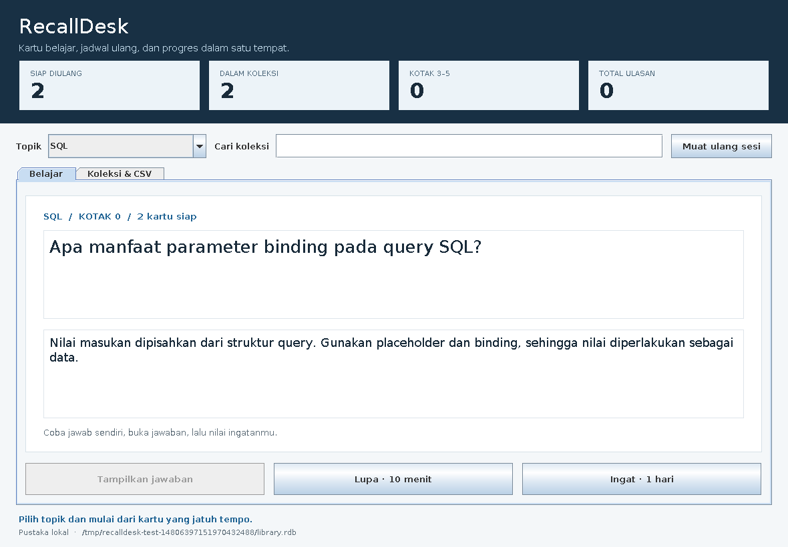
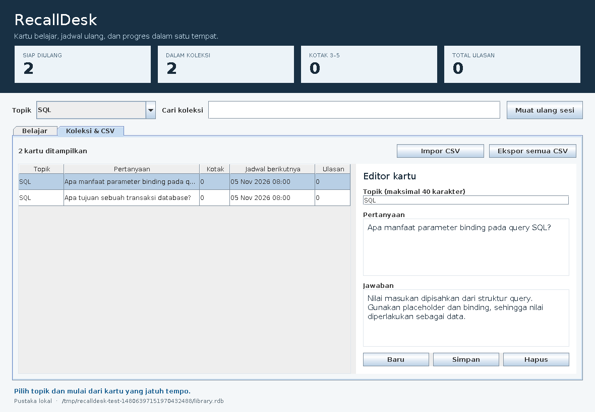

# RecallDesk

RecallDesk adalah aplikasi desktop Java Swing untuk membuat flashcard, belajar dengan sesi tanya-jawab, dan menyimpan jadwal pengulangan. Alurnya: **buat/impor kartu → pilih topik → coba jawab → buka jawaban → nilai ingatan → kembali saat jadwal berikutnya**.

Proyek harian 5 November 2026 · Java 17+ · tanpa dependensi eksternal · lisensi MIT.



## Lima fitur utama

1. **Koleksi kartu:** tambah, edit, hapus, kelompokkan per topik, dan cari isi pertanyaan/jawaban.
2. **Impor dan ekspor CSV:** mendukung UTF-8, koma, quote, serta field multiline. Impor divalidasi sebagai satu batch; duplikat atau baris rusak membatalkan seluruh impor.
3. **Sesi belajar:** kartu jatuh tempo ditampilkan dengan jawaban tertutup. Tombol penilaian baru aktif sesudah jawaban dibuka.
4. **Jadwal pengulangan:** sistem kotak 0–5 dengan interval tetap. Nilai “Ingat” memperpanjang jeda; nilai “Lupa” mengulang setelah 10 menit.
5. **Progres persisten:** kotak, jadwal, total ulasan dan jumlah lupa tersimpan; terdapat backup satu generasi, pemeriksaan checksum, serta lock agar satu pustaka tidak dibuka dua writer.

## Jalankan langsung

Ekstrak ZIP atau clone repositori, buka terminal pada folder proyek, lalu:

```sh
java -version
java -jar dist/recalldesk.jar --data latihan.rdb --sample
```

JAR siap jalan sudah disertakan. Java runtime 17 atau lebih baru cukup untuk menjalankan; kompilasi tidak diperlukan. Perintah berlaku di PowerShell, Command Prompt, Linux, atau macOS yang memiliki Java dan desktop/display.

`--sample` menambahkan enam kartu contoh pada pustaka kosong. Setelah data terisi, buka lagi dengan:

```sh
java -jar dist/recalldesk.jar --data latihan.rdb
```

Tanpa `--data`, aplikasi memakai `~/.recalldesk/library.rdb` pada home pengguna. Path data ditampilkan di bagian bawah aplikasi.

### Alur penggunaan

1. Pada tab **Koleksi & CSV**, klik **Baru**, isi topik, pertanyaan, dan jawaban, lalu **Simpan**. Pilih baris pada tabel untuk mengedit atau menghapus kartu.
2. Untuk memasukkan contoh dari berkas, klik **Impor CSV** dan pilih `examples/kartu-informatika.csv`. Pilih pustaka baru bila contoh yang sama sudah dimasukkan melalui `--sample`, karena pertanyaan duplikat akan ditolak.
3. Pilih topik di bagian atas. Pencarian teks memfilter tabel koleksi; angka progres mengikuti topik aktif.
4. Pada tab **Belajar**, pikirkan jawaban lalu klik **Tampilkan jawaban**. Pilih **Lupa** atau **Ingat**; penilaian disimpan dan kartu berikutnya ditampilkan.
5. Kembali pada jadwal berikutnya. Queue diperbarui setiap 30 detik saat aplikasi terbuka, atau melalui **Muat ulang sesi**. Membuka ulang aplikasi mempertahankan progres.



Penulisan, impor, dan ekspor berjalan melalui `SwingWorker`. Tombol yang dapat mengubah data dinonaktifkan selama proses. Jika penyimpanan gagal, perubahan tidak diterbitkan ke snapshot aplikasi dan draft editor tetap tersedia untuk diperbaiki. Tunggu proses selesai sebelum menutup jendela.

## Jadwal pengulangan

Kartu baru berada di kotak 0 dan langsung siap dipelajari.

| Kotak sebelum “Ingat” | Kotak sesudahnya | Jadwal berikutnya |
| --- | --- | --- |
| 0 | 1 | 1 hari |
| 1 | 2 | 3 hari |
| 2 | 3 | 7 hari |
| 3 | 4 | 14 hari |
| 4 | 5 | 30 hari |
| 5 | 5 | 30 hari |

Pada semua kotak, “Lupa” mengembalikan kartu ke kotak 0 dan menjadwalkannya 10 menit setelah penilaian. Satu hari berarti durasi 24 jam. Waktu disimpan sebagai timestamp dan ditampilkan memakai zona waktu komputer.

Ini adalah aturan pengulangan tetap yang mengambil konsep kotak Leitner. Penilaian dilakukan sendiri; angka “Kotak 3–5” menunjukkan posisi kartu dalam sistem, tanpa menyimpulkan tingkat penguasaan pengguna. Kartu belum jatuh tempo tidak dapat dinilai dua kali melalui panggilan review yang berulang.

Mengedit isi kartu mempertahankan progresnya. Menghapus kartu juga menghapus progres kartu tersebut. Belum tersedia undo penilaian atau sinkronisasi antarperangkat.

## CSV

Header wajib tepat `tag,front,back`. Contoh:

```csv
tag,front,back
SQL,Apa fungsi rollback?,Membatalkan perubahan transaksi yang belum committed.
Algoritma,"Apa itu queue, secara singkat?","Struktur FIFO: elemen pertama masuk, pertama keluar."
```

Aturan impor:

- Maksimal 1000 kartu per pustaka dan file maksimal 16 MiB.
- Topik wajib 1–40 karakter, pertanyaan 1–300, jawaban 1–4000. Batas panjang memakai unit UTF-16 Java.
- Teks dinormalisasi ke NFC dan spasi di ujung dibuang. CRLF/CR dalam field multiline menjadi LF.
- Topik tidak memuat karakter kontrol. Pertanyaan/jawaban boleh memuat newline dan tab, tetapi kontrol lain serta Unicode tidak valid ditolak.
- Pertanyaan pada topik yang sama harus unik setelah normalisasi; perbandingan case-sensitive. Duplikat di dalam satu CSV atau terhadap koleksi lama membatalkan seluruh batch.
- Quote pada field mengikuti aturan CSV: field diapit `"..."`, quote di dalamnya ditulis `""`. Baris kosong di tengah berkas akan divalidasi sebagai baris dan dapat ditolak.

**Ekspor semua CSV** membawa seluruh isi kartu, termasuk topik yang sedang tidak dipilih. Hasil tidak mencakup kotak/jadwal/progres. Impor hasil ekspor ke pustaka baru menghasilkan kartu baru dengan progres awal. Berkas tujuan ekspor harus belum ada; aplikasi menolak menimpa file lama.

## Penyimpanan dan backup

Untuk `latihan.rdb`, berkas pendampingnya adalah:

| Berkas | Isi |
| --- | --- |
| `latihan.rdb` | Snapshot kartu dan progres saat ini |
| `latihan.rdb.bak` | Snapshot sebelum perubahan terakhir yang berhasil disimpan |
| `latihan.rdb.lock` | Berkas koordinasi lock OS; boleh tetap ada setelah aplikasi ditutup |

Lock aktif mengikuti proses, bukan sekadar keberadaan file `.lock`. Membuka pustaka yang sama melalui proses RecallDesk lain akan ditolak. Gunakan satu filesystem lokal yang mendukung file locking dan atomic move; lokasi filesystem jaringan belum diuji.

Format pustaka berversi memuat payload Properties UTF-8 dan checksum SHA-256. Saat menyimpan, aplikasi menulis temporary file, melakukan flush ke file, lalu mengganti snapshot dengan atomic move. Backup generasi sebelumnya dibuat sebelum snapshot utama diganti. Snapshot dalam memori diperbarui setelah commit disk berhasil. Revisi juga diperiksa untuk menolak service yang memakai snapshot lama.

Jika file utama rusak atau hilang sementara backup masih ada, aplikasi menghentikan pemuatan data. Tutup aplikasi lalu pulihkan backup secara eksplisit:

```sh
java -jar dist/recalldesk.jar restore-backup --data latihan.rdb
java -jar dist/recalldesk.jar info --data latihan.rdb
```

Restore mengembalikan **seluruh snapshot generasi sebelumnya**, sehingga perubahan terakhir setelah snapshot tersebut ikut dikembalikan. Backup harus lolos validasi sebelum dipasang. Pertahankan salinan pustaka di lokasi lain untuk kebutuhan arsip jangka panjang.

Checksum mendeteksi kerusakan/perubahan byte; file data tetap merupakan data lokal yang dipercaya. Jangan menyunting format pustaka secara manual. Atomic move harus didukung filesystem; kegagalan dukungan tersebut dilaporkan. Pengujian mencakup kegagalan penulisan dan data rusak; kehilangan daya atau kerusakan media tidak disimulasikan.

## Perintah terminal dan demo

GUI memerlukan desktop/display. Perintah berikut dapat dipakai tanpa display:

```sh
java -jar dist/recalldesk.jar demo
java -jar dist/recalldesk.jar info --data belajar.rdb
java -jar dist/recalldesk.jar import --data belajar.rdb --csv examples/kartu-informatika.csv
java -jar dist/recalldesk.jar export --data belajar.rdb --csv kartu-baru.csv
java -jar dist/recalldesk.jar --help
```

Demo membuat direktori temporer dan memakai waktu tetap agar hasil dapat diulang. Output aktualnya:

```json
{"passed":16,"cards":6,"reviews_before_restore":2,"due_after_10_minutes":5,"csv_roundtrip":true,"backup_restore":true}
```

Demo mencakup tambah kartu, dua jenis penilaian, penolakan double review, CSV roundtrip, reopen, kemunculan kembali kartu setelah 10 menit, korupsi data, dan pemulihan backup. Seluruh berkas demo dibersihkan setelah selesai.

Exit code terminal: `0` berhasil, `2` argumen/input/IO bermasalah. Kesalahan ditulis ke stderr. Memulai GUI tanpa display ditolak sebelum membuat pustaka.

## Struktur dan keputusan teknis

| Modul | Tanggung jawab |
| --- | --- |
| `Card`, `Library` | Model immutable, validasi teks dan invariant koleksi |
| `Scheduler` | Transisi kotak dan interval berbasis `Instant` |
| `StudyService` | Alur CRUD, queue, statistik, review, dan commit setelah validasi |
| `Csv` | Parser/writer CSV, UTF-8 ketat, batch yang divalidasi utuh |
| `Codec`, `Store` | Format berversi, checksum, backup, lock dan replace atomik |
| `AppPanel`, `Main` | Antarmuka Swing, worker IO, argumen CLI dan lifecycle aplikasi |
| `Demo` | Alur integrasi dengan waktu tetap dan data sementara |
| `test/` dan `tools/smoke.py` | Tes Java, interaksi panel, pemeriksaan JAR dan oracle CSV Python |

Pendalaman teknis proyek ini adalah **antarmuka, penjadwalan domain, dan penyimpanan persisten yang terintegrasi**. Swing dipilih agar aplikasi dapat berjalan offline menggunakan Java standard library. File snapshot dipilih untuk pustaka pribadi kecil tanpa memasang database/server; seluruh perubahan divalidasi sebelum satu snapshot committed. Clock dapat diinjeksi agar batas waktu dapat diuji tanpa menunggu waktu nyata. File data tidak menjalankan Java object deserialization.

## Build dan pengujian

Build source memerlukan **JDK 17+** yang menyertakan compiler API:

```sh
java Build.java
java Build.java test
python tools/smoke.py
```

Build memakai `--release 17 -encoding UTF-8 -Xlint:all -Werror`. Tidak memerlukan Maven, Gradle, unduhan dependensi, atau binary `javac` terpisah di PATH. Hasil build berada di `dist/recalldesk.jar`.

Hasil aktual: 37 tes Java lulus, termasuk tujuh pemeriksaan komponen/flow Swing secara headless dan 10.000 langkah review; 19 pemeriksaan integrasi JAR lulus; delapan kasus oracle CSV memeriksa total 200 kartu dengan parser Python. Detail lingkungan dan batas pemeriksaan ada di [VERIFICATION.md](VERIFICATION.md).

Gambar di README merupakan hasil render panel Swing yang diimplementasikan. Jendela native, file chooser, dan dialog OS belum diuji langsung karena lingkungan pengerjaan tidak memiliki display server. Pengujian dilakukan pada OpenJDK 17.0.20/Linux; eksekusi native Windows/macOS belum diverifikasi.

Referensi API: [Swing dan EDT](https://docs.oracle.com/en/java/javase/17/docs/api/java.desktop/javax/swing/package-summary.html), [SwingWorker](https://docs.oracle.com/en/java/javase/17/docs/api/java.desktop/javax/swing/SwingWorker.html), [FileChannel](https://docs.oracle.com/en/java/javase/17/docs/api/java.base/java/nio/channels/FileChannel.html), dan [atomic move](https://docs.oracle.com/javase/tutorial/essential/io/move.html).
